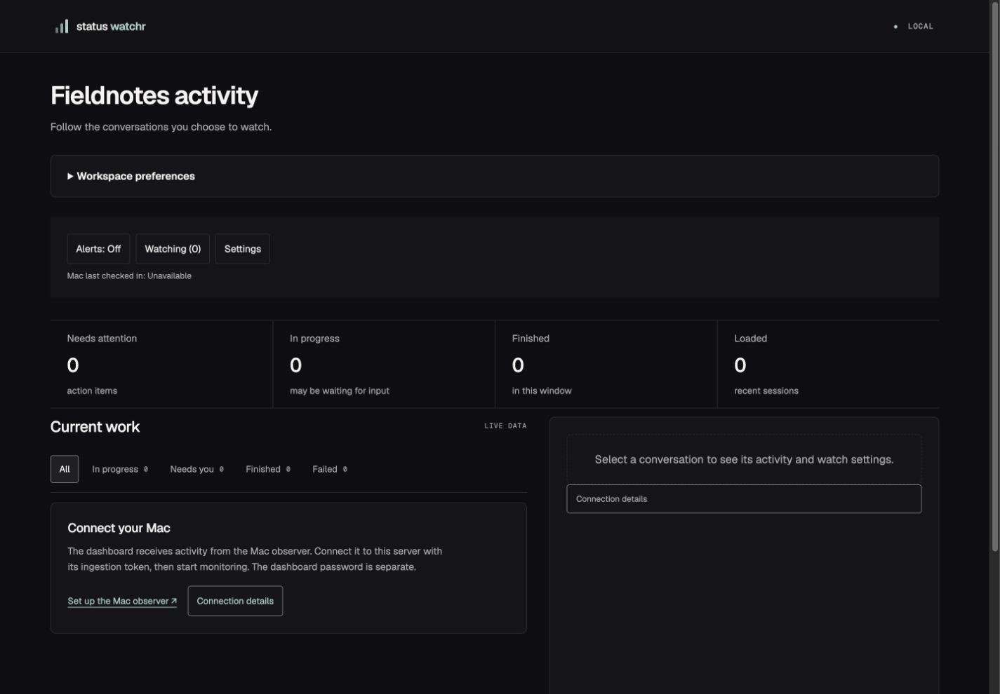
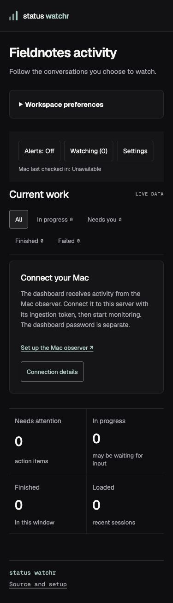

# Public-readiness refinements, November 7, 2026

Local changes on `kylebutler/public-readiness`, based on main `d46aa76a9ca6a866925ca9be1dffd1f3b341d30d`. No release, deployment, visibility change, or native installation was performed.

## Changes

- Move actionable first-use Mac setup into the activity column, visible on desktop and phones.
- Separate first-use setup, stale observer, unavailable source, connected-but-empty, empty filter, loading, and failed-request states.
- Let an empty filter return to All and a failed request retry, without starting monitoring or enabling alerts.
- Link to pairing instructions and clarify independent server/Mac release channels, local signing, and the lack of Apple notarization.
- Mark the initial release plan as historical, preserving its original evidence.

## Validation

- Node 24.18.0: typecheck, 24 test files / 172 tests, and `build:standalone` passed.
- New rendered-App tests cover mobile-visible setup, source/stale state transitions, empty-filter recovery, and failed-request retry. Initial requests remain read-only.
- Reviewed the production build at 1440 x 1000 and 390 x 844 in the in-app browser. Setup actions measured 44px tall and mobile had no horizontal overflow. The empty-filter return and connection-details actions worked.
- Reviewed the current App Stylr v1.4.3 Controls reference while retaining the app's pinned v1.4.1 adapters. The source detector found only three intentional Geist-family warnings.

The screenshots use fictional browser-local display preferences and a fresh, disposable server database. No personal activity, credentials, collector, notification device, or Mac application was accessed. Responsive viewport checks do not prove physical-device, keyboard-overlay, native installation, or phone-delivery acceptance.

## Lifecycle

One five-minute preview maximum on port 4288, managed session 32907, wrapper PID 5688 and server PID 6367. It was stopped with Ctrl+C and the port was verified closed. Temporary IAB tab 12 was closed and the viewport override reset. The app did not start a collector or register notifications.

## Recommended Next Steps

Review these changes before authorizing a branch push/PR. Native installation and physical phone delivery need separate acceptance before any replacement Mac release is advertised as verified.
